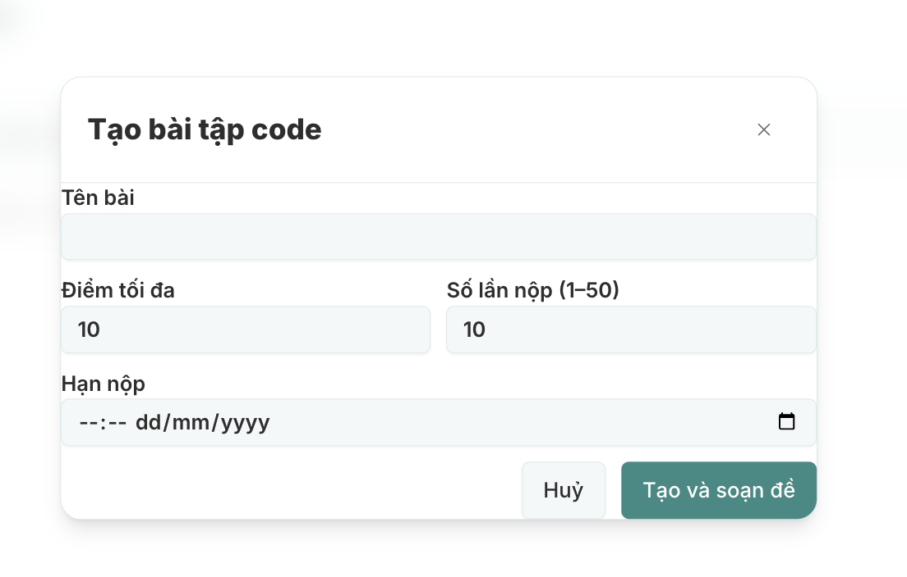
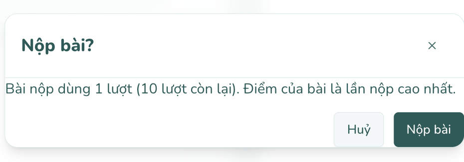

# Ghi chú sửa UI compiler — modal tạo đề và nộp bài

- Ngày ghi nhận: **04/11/2026**.
- Trang: [Chi tiết buổi học Mentor](https://mindy-fe-2.vercel.app/mentor/sessions/6a867a15-dcc8-4b5a-b7b8-9b8b8f4b897e).
- Cách mở: Lớp của tôi → chọn lớp → Buổi học → mở buổi → Bài tập code → Tạo bài code.
- Trạng thái: **Đã sửa 04/11/2026** (modal tạo bài CODE và modal Nộp bài?). UI-04 (kiểm tra responsive 320/390/768 px) cần chạy e2e/duyệt tay trên máy thật.
- Bằng chứng: ảnh người dùng gửi và đối chiếu source local nhánh dev sau merge compiler. Chưa đo computed styles trên website, chưa kiểm tra lại trang bằng tài khoản Mentor.

## Tổng hợp

| ID    | Ưu tiên | Vấn đề                                                | Bằng chứng                                       | Trạng thái                                   |
| ----- | ------- | ----------------------------------------------------- | ------------------------------------------------ | -------------------------------------------- |
| UI-01 | P2      | Nội dung form sát mép modal, không thẳng hàng tiêu đề | Thấy trong ảnh; source xác nhận thiếu padding    | [x] Đã sửa 04/11                             |
| UI-02 | P2      | Hàng nút sát mép phải và đáy modal                    | Thấy trong ảnh; source xác nhận thiếu khoảng đệm | [x] Đã sửa 04/11                             |
| UI-03 | P2      | Modal CODE chưa dùng scope typography của bài tập     | Source xác nhận; cần đối chiếu font/size thực tế | [x] Đã sửa 04/11                             |
| UI-04 | P3      | Cần kiểm tra bố cục và khoảng cách ở màn hình nhỏ     | Suy ra từ source; chưa tái hiện mobile           | [ ] Chưa kiểm tra                            |
| UI-05 | P3      | Ô hạn nộp cần chỉ dẫn rõ ngày/giờ và múi giờ          | Ảnh có placeholder native; đề xuất cải thiện     | [x] Thêm chỉ dẫn "theo giờ trên máy của bạn" |
| UI-06 | P3      | Nút tạo thiếu phản hồi bằng chữ lúc đang gửi          | Source xác nhận chỉ disable nút                  | [x] Đã sửa 04/11                             |

**Bổ sung UI-07 (P2) — đã sửa 04/11:** modal xác nhận nộp bài của Student cũng thiếu padding thân/footer và chưa áp scope typography bài tập; chi tiết và ảnh ở mục UI-07 bên dưới.

P2: lỗi trình bày nên sửa trong đợt UI tiếp theo. P3: cải thiện hoặc kiểm tra bổ sung. Không có bằng chứng từ ảnh rằng việc tạo bài/API đang lỗi.

## UI-01 — Thêm padding cho phần nội dung form

**Hiện tại**

- Tiêu đề được thụt vào nhưng nhãn “Tên bài”, “Điểm tối đa”, “Hạn nộp” bắt đầu gần sát viền trái.
- Ô nhập kéo dài tới sát viền phải.
- Nhãn đầu tiên quá gần đường phân cách dưới header, khiến phần đầu và thân modal thiếu nhịp khoảng cách.

**Nguyên nhân trong source**

- Modal chung đặt DialogContent là **p-0**, còn header có **p-5**.
- Form tạo CODE chỉ có **space-y-3**, không có padding.
- Vì vậy phần children không có khoảng đệm do Modal cung cấp sẵn.

**Vị trí**

- [Form tạo CODE](../src/features/code-assignments/components/mentor-session-assignments.tsx), đoạn Modal/form gần dòng 96–97.
- [Modal chung](../src/components/ui/modal.tsx), DialogContent/header gần dòng 69–78.

**Hướng sửa**

- Thêm khoảng đệm cho form hoặc wrapper của riêng modal tạo CODE, ví dụ p-5 phù hợp header hiện tại.
- Có thể tăng khoảng cách giữa các nhóm trường lên mức tương đương gap/space 4 theo component bài tập đang dùng.
- Ưu tiên sửa tại caller; nếu đổi padding mặc định của Modal chung, phải rà soát các caller đã tự có padding để tránh bị cộng hai lần.

**Tiêu chí hoàn tất**

- [ ] Mép trái nhãn/ô nhập thẳng hàng với tiêu đề.
- [ ] Mép phải ô nhập có khoảng cách rõ với viền modal.
- [ ] Có khoảng trống giữa đường phân cách header và nhãn “Tên bài”.

## UI-02 — Tách hàng thao tác khỏi mép dưới/phải

**Hiện tại**

- Nút “Tạo và soạn đề” chạm gần mép phải và đáy.
- Góc nút nằm rất gần góc bo của modal, làm footer có cảm giác bị ép/cắt.
- Nút “Huỷ” cũng không có khoảng đệm dưới.

**Vị trí**

- [Hàng nút trong form](../src/features/code-assignments/components/mentor-session-assignments.tsx), gần dòng 140–147.

**Hướng sửa**

- Giữ Hủy là thao tác phụ và Tạo và soạn đề là thao tác chính.
- Nếu hàng nút nằm trong form đã thêm padding, dùng khoảng đệm đó; không cần thêm một lớp padding trùng.
- Nếu tách thành footer riêng, cho footer padding ngang/dưới đồng nhất với thân và header; có khoảng cách phía trên.
- Trên màn nhỏ cho phép xuống hàng hoặc xếp dọc khi không đủ chỗ.

**Tiêu chí hoàn tất**

- [ ] Hai nút không chạm viền/góc modal và không bị cắt.
- [ ] Khoảng cách từ nút tới mép phải/đáy nhìn đồng nhất với phần còn lại.
- [ ] Trạng thái focus của nút không bị clipping.

## UI-03 — Đồng bộ font và thang chữ với giao diện bài tập

**Hiện tại và giới hạn bằng chứng**

- Ảnh cho thấy heading/nhãn/nút khá lớn, nhưng không biết mức zoom trình duyệt nên chưa kết luận sai kích thước CSS tuyệt đối.
- Source xác nhận Modal mặc định có **admin-typography**.
- Modal tạo CODE chưa truyền **contentClassName="assignment-workspace font-sans"** như một số modal bài tập khác.
- Dialog dùng portal, nên không nên giả định typography của khối bài tập bên ngoài sẽ tự áp vào nội dung modal.

**Vị trí**

- [Caller tạo CODE](../src/features/code-assignments/components/mentor-session-assignments.tsx).
- [Scope assignment](../src/app/globals.css), đầu file.
- [Typography staff](../src/app/admin/admin.css), class admin-typography.
- [Modal bài tập dùng chung để tham khảo](../src/features/assignments/components/assignment-ui.tsx), component Confirm.
- [Quy tắc UI](ui-rules.md) và [chuẩn giao diện Student](student-ui-standard.md).

**Hướng sửa**

- Áp dụng scope bài tập vào chính dialog content.
- Đối chiếu font Nunito, thang chữ và controls của assignment hiện hữu.
- Giữ palette/token và component chung. Không đổi font toàn bộ shell Mentor để sửa một modal.
- Kiểm tra nút đóng sau khi áp scope: scope hiện đặt min-height cho button, cần bảo đảm hình dạng/vùng bấm của nút X vẫn cân đối.

**Tiêu chí hoàn tất**

- [ ] Font/nhãn/heading thống nhất với phần bài tập.
- [ ] Thứ bậc heading → label → input → button rõ ràng ở zoom 100%.
- [ ] Nút đóng có vùng bấm đủ lớn và canh giữa trong header.

## UI-04 — Kiểm tra responsive sau khi thêm padding

**Chưa xác nhận bằng ảnh mobile**

- Hàng Điểm tối đa / Số lần nộp hiện dùng **grid-cols-2** ở mọi kích thước.
- Footer hiện chỉ có flex justify-end, chưa có wrap hay bố cục riêng cho màn nhỏ.
- Modal caller không chỉ định min-width cho các nhóm trường; cần kiểm tra input date/time native trên nhiều trình duyệt.

**Hướng sửa nếu kiểm tra thấy chật/tràn**

- Cân nhắc grid một cột trên màn hẹp và hai cột từ breakpoint phù hợp.
- Giữ khoảng hở giữa dialog và mép viewport.
- Cho body cuộn theo chiều dọc khi chiều cao nhỏ/bàn phím mở; mọi field và nút chính vẫn truy cập được.

**Tiêu chí hoàn tất**

- [ ] Kiểm tra chiều rộng 320, 390, 768 px và desktop.
- [ ] Kiểm tra zoom 200%, tên bài dài và thông báo lỗi dài.
- [ ] Không cuộn ngang; input và nút không chồng nhau.
- [ ] Trên mobile, mở bàn phím vẫn tới được trường cuối và nút tạo.

## UI-05 — Làm rõ ô hạn nộp

**Quan sát**

- Ảnh hiển thị ô native datetime-local với thời gian đứng trước ngày.
- Thứ tự và placeholder có thể do hệ điều hành/trình duyệt/locale, chưa đủ bằng chứng coi đó là lỗi component.
- Nhãn hiện chỉ ghi “Hạn nộp”, chưa nói múi giờ.

**Hướng sửa**

- Cân nhắc ghi “Hạn nộp (giờ Việt Nam)” và thêm hướng dẫn ngắn nếu cần.
- Kiểm tra Safari/Chrome và locale vi/en trước khi thay bằng date picker riêng.
- Nếu UI hứa hiển thị/nhập giờ Việt Nam, cần kiểm tra cả chuyển đổi giá trị: code hiện dùng new Date(form.dueAt).toISOString(), vốn hiểu datetime-local theo múi giờ thiết bị.
- Không chỉ đổi nhãn múi giờ khi việc chuyển đổi chưa được xác minh.

**Tiêu chí hoàn tất**

- [ ] Người dùng hiểu đang chọn ngày lẫn giờ và hạn nộp theo múi giờ nào.
- [ ] Thời điểm gửi API và hiển thị lại đúng với thời điểm người dùng chọn.
- [ ] Không làm hỏng thao tác chọn lịch native hoặc bàn phím.

## UI-06 — Thêm trạng thái đang tạo

**Hiện tại**

- Nút chính được disable theo create.isPending nhưng chữ vẫn là “Tạo và soạn đề”.
- Chỉ nút chính bị disable; việc khóa toàn bộ form hoặc đóng modal khi đang tạo chưa được quy định rõ ở component.
- Đây là điểm thấy trong source, không phải lỗi đã tái hiện trong ảnh.

**Hướng sửa**

- Hiển thị chữ như “Đang tạo…” và spinner theo pattern hiện có.
- Cân nhắc khóa các field khi gửi để người dùng không sửa một bản khác với request đang được xử lý.
- Quy định rõ hành vi Hủy/X khi pending; không tự thay đổi cách retry/idempotency của API trong đợt sửa UI.

**Tiêu chí hoàn tất**

- [ ] Nhìn được tiến trình đang gửi và không bấm gửi lặp.
- [ ] Lỗi trả về hiển thị trong phần thân có padding, giữ dữ liệu đã nhập.
- [ ] Thành công vẫn chuyển đúng sang trang soạn đề.

## UI-07 — Modal xác nhận “Nộp bài?” của Student

**Bổ sung ngày 04/11/2026, từ ảnh chụp lúc 18:10:17.**

- Trang: [Bài tập Student](https://mindy-fe-2.vercel.app/user/assignments/8e6a3711-3832-4e75-abb1-2015c2b7cae3?classId=20f1e651-5319-4f17-887b-e1726f465168).
- Cách mở: vào bài tập → bấm **Nộp bài** → modal xác nhận **Nộp bài?**.
- Trạng thái: **Chưa sửa**, chỉ ghi nhận.

**Các điểm cần sửa**

1. **Thân modal sát viền:** đoạn “Bài nộp dùng 1 lượt…” bắt đầu sát mép trái, không thẳng hàng với tiêu đề; thiếu khoảng trống sau đường phân cách header.
2. **Footer sát đáy/phải:** nút Nộp bài nằm sát góc phải dưới; hàng nút Hủy/Nộp bài thiếu padding dưới và ngang.
3. **Typography chưa theo scope bài tập:** cần đồng bộ font/thang chữ giống UI-03. Không suy ra kích thước CSS chính xác từ ảnh vì chưa biết mức zoom.
4. **Cần kiểm tra responsive:** đoạn giải thích dài và hai nút cần wrap/xếp lại hợp lý khi màn hẹp. Ảnh không đủ để khẳng định modal đang tràn viewport; cần đo ở 320/390 px và zoom 200%.

**Nguyên nhân đối chiếu source**

- [StudentCodePage / Workspace](../src/features/code-assignments/components/student-code-page.tsx), gần dòng 283–295: Modal nhận children là div chỉ có space-y-4; hàng nút chỉ có flex justify-end gap-3.
- Children không có padding, trong khi [Modal chung](../src/components/ui/modal.tsx) đặt content p-0 và chỉ header có p-5.
- Caller này cũng chưa truyền scope assignment-workspace vào dialog content.
- Đây là cùng kiểu lỗi với modal tạo CODE ở UI-01/UI-02; nên sửa đồng bộ cả hai caller theo một quy ước.

**Hướng sửa**

- Thêm padding thân/footer tại caller hoặc dùng wrapper modal bài tập hiện hữu để đồng nhất header/body/footer.
- Áp scope typography bài tập vào dialog content, kiểm tra cả nút X sau khi áp scope.
- Cho nội dung xuống dòng tự nhiên và hàng nút thích ứng chiều rộng; tránh chiều cao/kích thước cứng.
- Giữ nội dung xác nhận số lượt và cách lấy điểm cao nhất; đợt này ghi nhận lỗi trình bày.

**Tiêu chí hoàn tất**

- [ ] Đoạn giải thích thẳng hàng với tiêu đề, có khoảng trống hai bên và phía trên.
- [ ] Hai nút có khoảng đệm dưới/phải, không chạm góc bo; focus ring không bị cắt.
- [ ] Không tràn ngang hoặc cắt chữ ở 320/390 px và zoom 200%.
- [ ] Font/thang chữ thống nhất với modal tạo CODE và giao diện bài tập Student.
- [ ] Hủy/X/Escape đóng đúng, trả focus về nút Nộp bài ban đầu.
- [ ] Bấm xác nhận vẫn gửi đúng source/ngôn ngữ và nhận kết quả như trước.

## Checklist kiểm tra cuối đợt sửa

- [ ] Kiểm tra cả modal tạo CODE với Mentor và modal xác nhận nộp bài với Student trên các URL đã ghi.
- [ ] Chụp ảnh trước/sau ở desktop và mobile.
- [ ] Tab/Shift+Tab nằm trong dialog; Escape/Hủy/X đóng đúng và trả focus về nút mở.
- [ ] Không ảnh hưởng các modal QUIZ/ZIP, chat hoặc màn khác dùng Modal chung.
- [ ] Nghiệp vụ giữ đúng: title, maxScore, maxAttempts 1–50, dueAt và điều hướng sang soạn đề.
- [ ] Cập nhật trạng thái từng mục kèm bằng chứng sau khi sửa.

Tài liệu được tạo từ ảnh và source; chưa thực hiện thay đổi component, CSS, API, commit/push hoặc deploy trong lượt ghi chú này.
