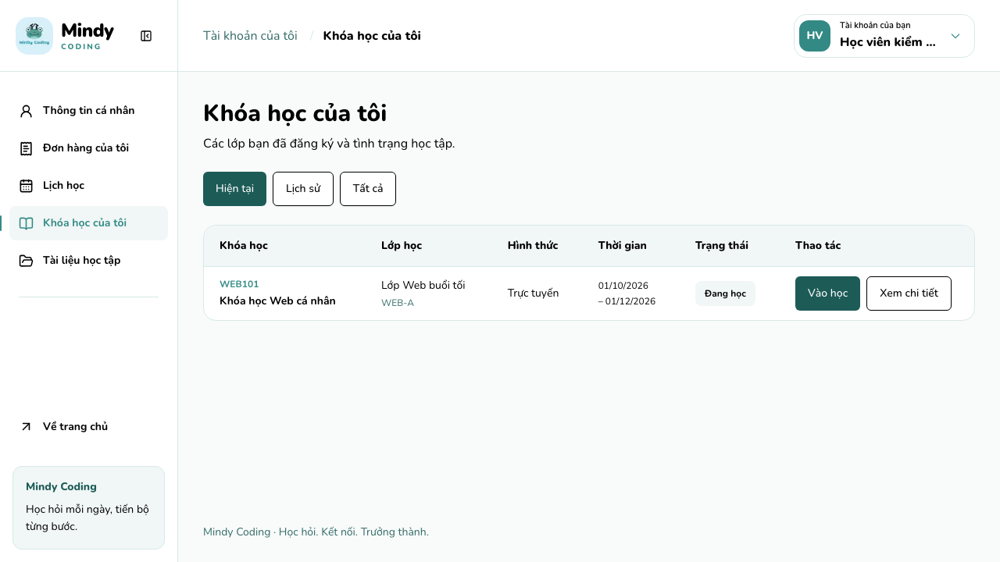
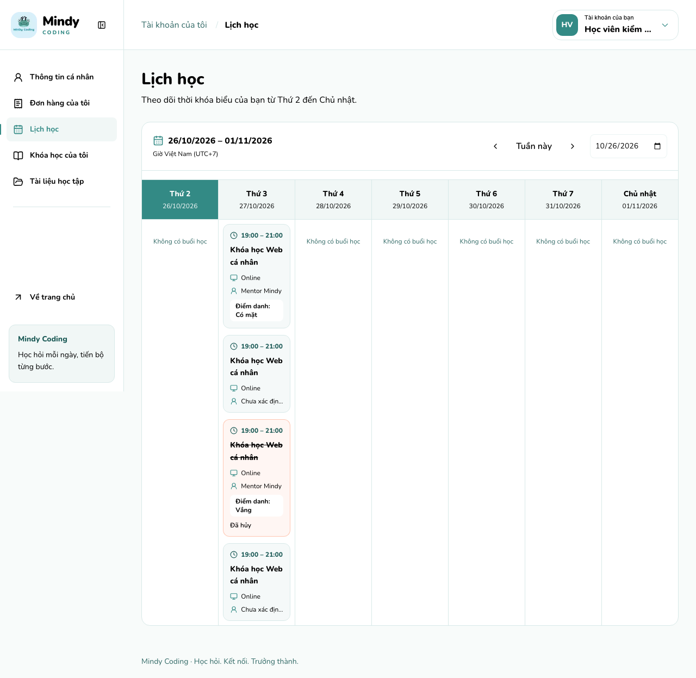
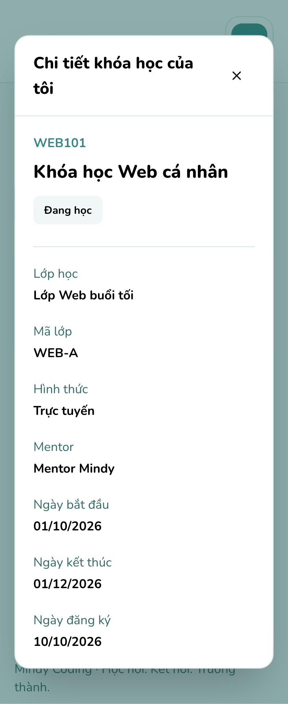
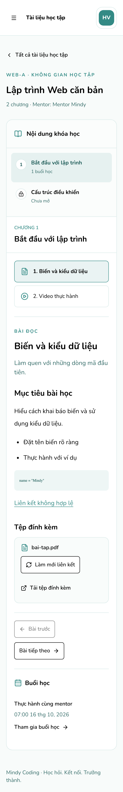

# Chuẩn UI Mindy FE2 — lấy Student làm mẫu

Ngày khảo sát: **26/10/2026**. Mã nguồn tham chiếu: **`8791224`**. Phạm vi: **Mindy-FE2**.

Tài liệu dành cho người thiết kế, lập trình và nghiệm thu giao diện Admin, Manager, Mentor. Mục tiêu là thống nhất ngôn ngữ giao diện với Student: **Nunito, palette Mindy, thang chữ, bo góc, khoảng cách và phản hồi tương tác**. Menu, dữ liệu, quyền và quy trình nghiệp vụ vẫn theo từng role.

**Trạng thái: mới hoàn tất khảo sát và tài liệu; chưa chuyển font hoặc sửa UI staff.** Quyết định Nunito cho mọi role ngày 26/10/2026 thay thế định hướng giữ Inter cho staff trong các mục lịch sử của [ui-rules.md](ui-rules.md). Các quy tắc nghiệp vụ ở đó vẫn có hiệu lực.

## Mục lục

1. [Cách đọc và chuẩn tra nhanh](#1-cách-đọc-và-chuẩn-tra-nhanh)
2. [Bản đồ màn hình và luồng người dùng](#2-bản-đồ-màn-hình-và-luồng-người-dùng)
3. [Shell, điều hướng và tài khoản](#3-shell-điều-hướng-và-tài-khoản)
4. [Typography](#4-typography)
5. [Màu và ý nghĩa sử dụng](#5-màu-và-ý-nghĩa-sử-dụng)
6. [Bo góc, kích thước, khoảng cách và shadow](#6-bo-góc-kích-thước-khoảng-cách-và-shadow)
7. [Bảng, bộ lọc và dialog chi tiết](#7-bảng-bộ-lọc-và-dialog-chi-tiết)
8. [Lịch học và không gian học tập](#8-lịch-học-và-không-gian-học-tập)
9. [Trang public, xác thực và thương mại](#9-trang-public-xác-thực-và-thương-mại)
10. [Trạng thái, bàn phím và responsive](#10-trạng-thái-bàn-phím-và-responsive)
11. [Đối chiếu và hướng áp dụng cho staff](#11-đối-chiếu-và-hướng-áp-dụng-cho-staff)
12. [Bằng chứng và kiểm chứng](#12-bằng-chứng-và-kiểm-chứng)
13. [Checklist nghiệm thu từng role](#13-checklist-nghiệm-thu-từng-role)

## 1. Cách đọc và chuẩn tra nhanh

- **Hiện trạng**: hành vi hoặc giá trị đang có trong code Student/shared/staff. Có dẫn nguồn; không mặc định rằng tất cả đều đã đồng nhất hoặc đạt accessibility.
- **Chuẩn đích**: quyết định để các lần đồng bộ UI sau áp dụng. Những chỗ khác hiện trạng được ghi rõ là **đề xuất chuẩn hóa**, chưa được triển khai trong lần viết tài liệu này.
- **Ngoại lệ**: khác biệt có mục đích, ví dụ CTA marketing, code monospace, bảng nghiệp vụ hoặc editor. Không sao chép bố cục Student vào mọi workflow.

Các giá trị px dưới đây quy đổi từ rem với cỡ gốc trình duyệt **16px**; không yêu cầu khóa root font-size. Breakpoint dùng rem. Kích thước ảnh chụp có thể lớn hơn CSS pixel do device scale factor.

| Hạng mục            | Chuẩn đích để áp dụng nhanh                                                         | Căn cứ / lưu ý                                                                              |
| ------------------- | ----------------------------------------------------------------------------------- | ------------------------------------------------------------------------------------------- |
| Font UI             | Nunito Variable; fallback Nunito, Arial, sans-serif                                 | [RootLayout][root-layout], [globals][globals]; quyết định dùng cho mọi role                 |
| Chữ                 | Thang Tailwind gốc; bảng/nhãn 14px, nội dung 16px; h1 workspace 24px → 30px từ `sm` | [Student courses][my-courses]; bỏ phụ thuộc thang chữ staff riêng ở lần triển khai sau      |
| Nền / viền          | Workspace `bg-soft/50`, panel `bg-canvas border-line`                               | `.user-workspace` trong [globals][globals]                                                  |
| Chữ workspace       | Nội dung đen; metadata `muted`, điểm nhấn `mint`                                    | [UserShell][user-shell], [hồ sơ][profile]; dùng token `ink` đã có nếu cần thay `text-black` |
| Nút chính workspace | Forest / chữ trắng; hover forest 90%                                                | `Button` mặc định và alias `primary` trong [globals][globals]                               |
| Góc điều khiển      | **Đề xuất chuẩn hóa:** 8px; CTA lớn/form auth 12px                                  | Shared Button hiện 6px, nhiều control Student hiện 8px; xem mục 6                           |
| Góc panel / dialog  | 16px; thẻ nhỏ bên trong 12px                                                        | [bảng Student][my-courses], [dialog Student][user-dialog]                                   |
| Vùng tương tác      | **Chuẩn đích:** tối thiểu 44px cho nút/control tương tác chính                      | Hiện một số icon chỉ 36/40px; ghi riêng ở mục 6                                             |
| Gutter workspace    | 16px mobile, 32px từ `sm`; padding dọc 28px → 36px                                  | `.user-main` trong [globals][globals]                                                       |
| Responsive          | Từ 320px; bảng/code/PDF cuộn trong vùng riêng                                       | [lịch Student][schedule], [viewer][material-viewer]                                         |

## 2. Bản đồ màn hình và luồng người dùng

### 2.1. Student đã đăng nhập

`/user` chuyển đến `/user/profile`. Toàn bộ nhánh nằm trong `UserShell` với `AuthGuard role="STUDENT"`: phải có session, role STUDENT và status ACTIVE. Đợi kiểm tra session trước khi hiển thị nội dung; sai quyền/không đăng nhập chuyển về `/`; lỗi kết nối kiểm tra phiên có thông báo và Thử lại. Không đổi thành redirect `/login` khi chỉ đồng bộ giao diện. Nguồn: [route mặc định][user-entry], [guard][auth-guard].

| Màn hình                   | Nội dung / cách tương tác hiện tại                                                     | State và điều kiện cần giữ                                                                                | Nguồn                                                            |
| -------------------------- | -------------------------------------------------------------------------------------- | --------------------------------------------------------------------------------------------------------- | ---------------------------------------------------------------- |
| `/user/profile`            | Banner mint, avatar icon, tên/email; thông tin đọc bằng `dl`, hai cột từ `sm`          | Lấy từ session; điện thoại thiếu ghi Chưa cập nhật; **chưa có form sửa hồ sơ**                            | [ProfilePage][profile]                                           |
| `/user/orders`             | Bảng tóm tắt, lọc trạng thái; Xem chi tiết mở dialog trong trang                       | Đổi trạng thái về trang 1 và xóa lựa chọn; đổi trang cũng đóng lựa chọn; chỉ PAYOS có link xem thanh toán | [UserOrdersPage][orders]                                         |
| `/user/schedule`           | Tuần Thứ 2–Chủ nhật; tuần trước/sau, Tuần này, chọn ngày; bấm ô mở chi tiết            | Mỗi lần đổi tuần/ngày xóa lựa chọn; lịch hủy và điểm danh là hai thông tin riêng                          | [UserSchedulePage][schedule]                                     |
| `/user/courses`            | Bảng; ba nút Hiện tại / Lịch sử / Tất cả; Vào học / Xem trước chương / Xem chi tiết    | Đổi nhóm về trang 1 và đóng chi tiết; hành động theo `canViewClass`, `accessMode`, `canViewSchedule`      | [MyCoursesPage][my-courses]                                      |
| `/user/materials`          | Card lớp được truy cập; Vào học hoặc Xem trước chương                                  | Tải đủ danh sách rồi lọc quyền, phân trang client 10 mục; không chỉ lọc trên trang API đầu                | [MaterialsPage][materials], [learning queries][learning-queries] |
| `/user/materials/:classId` | Chọn chương → chọn bài → đọc bài/video/tệp; Bài trước / Bài tiếp theo; buổi học nếu có | `?preview=true` dùng API preview; chương khóa không tải danh sách học liệu; UUID sai dùng not-found       | [LearningPage][learning], [route học][learning-route]            |

Orders/My Courses dùng phân trang **server 10 dòng/trang**. Lịch tải **đủ các trang API 100 mục/trang** trong tuần, gộp theo `sessionId + enrollmentId + makeupPlacementId` rồi sắp giờ bắt đầu. Nếu total/page thay đổi bất thường khi tải lịch thì báo lỗi để thử lại. Các state lọc/trang/tuần ở component, **chưa lưu trên URL**, khác một số màn Manager. Nguồn: [user queries][user-queries].

### 2.2. Người dùng public và luồng đăng ký

Luồng tổng thể: **Trang chủ → danh sách khóa học → chi tiết → chọn lớp/lịch → thêm giỏ → tạo đơn → QR/payOS → đọc kết quả đơn từ backend**. Có thể xem khóa học, giáo trình, lớp đang mở và lịch lớp khi chưa đăng nhập. CTA đăng ký chính kiểm tra lại session; chọn lớp từ khu Mentor có thể mở picker public. Thêm giỏ yêu cầu Student. Xem mục 9 để giữ đúng từng điểm kiểm tra quyền.

## 3. Shell, điều hướng và tài khoản

### 3.1. Bố cục Student hiện tại và chuẩn dùng lại

| Thành phần           | Class / kích thước hiện tại                                       | Quy tắc áp dụng                                                          |
| -------------------- | ----------------------------------------------------------------- | ------------------------------------------------------------------------ |
| Shell                | `min-h-dvh bg-soft/50 text-black`; từ `lg`: `228px minmax(0,1fr)` | Nền workspace nhẹ, panel trắng; phần nội dung phải có `min-w-0`          |
| Sidebar mở / thu gọn | 228px / 76px; `sticky top-0 h-dvh`, border phải                   | Giữ thu gọn bằng state local, không giả định lưu qua reload              |
| Header sidebar       | `h-23` = 92px                                                     | Căn logo và nút thu gọn theo cùng chiều cao topbar                       |
| Topbar               | `min-h-23`, `px-4 sm:px-8`, `gap-3`, nền trắng, border dưới       | Header Student không có `sticky`; không tự ghi thành header luôn cố định |
| Main                 | `max-w-400` = 1600px; `px-4 py-7 sm:px-8 sm:py-9`                 | Không dùng nhầm container public 1280px                                  |
| Navigation           | `min-h-11 gap-3 rounded-lg px-3 text-sm font-bold`; icon 19px     | Active khi URL bằng route hoặc bắt đầu bằng route + `/`                  |
| Navigation active    | `bg-soft text-mint`, vạch mint 2 × 20px bên trái                  | Có `aria-current="page"`; đừng dựa riêng vào màu                         |
| Breadcrumb topbar    | Tên mục hiện tại; tiền tố Tài khoản của tôi chỉ hiện từ `xl`      | Role khác giữ nhãn phù hợp với không gian của role                       |
| Footer Student       | `px-4 py-5 text-sm text-muted sm:px-8`                            | Footer là thành phần của Student; không bắt staff thêm footer            |

Nguồn cho bảng: các class `.user-*` trong [globals][globals], component [UserShell][user-shell] và [userNavigation][user-navigation].

Menu Student có **5 mục**, bao gồm Tài liệu học tập. Không dùng mô tả lịch sử “4 mục” làm nguồn hiện hành. Sidebar có Về trang chủ và thẻ Mindy Coding; các sidebar staff đã chủ động bỏ hai phần này theo quy tắc ngày 23/10, **tiếp tục giữ ngoại lệ đó**.

### 3.2. Mobile và dropdown tài khoản

- Dưới `lg` ẩn sidebar desktop; nút menu mở native dialog bên trái, `w-72` = 288px, tối đa chiều rộng viewport trừ 32px, cao `100dvh`. Dialog không áp bo tròn của panel giữa màn. Escape hoặc chọn link đóng menu, khôi phục cuộn body và trả focus. [UserShell][user-shell].
- Tài khoản dùng nút cao tối thiểu 56px, góc 16px; avatar 40px, góc 12px. Mobile chỉ giữ avatar; tên/chevron hiện từ `sm`. Tên dài truncate. [SessionControls][session-controls].
- Dropdown rộng 288px nhưng bị giới hạn bởi viewport; góc 16px, border line, shadow forest nhẹ. Đóng khi bấm ngoài, rời focus đến phần tử ngoài hoặc Escape; Escape đưa focus về nút mở. Link điều hướng đóng dropdown. Đây là `region` có tên, không phải menu Radix có sẵn điều hướng phím mũi tên. [SessionControls][session-controls].
- Dropdown Student chỉ đưa Thông tin cá nhân và Lịch học; không cần lặp đủ 5 mục sidebar. Staff nhận link về không gian đúng role. Đăng xuất khóa nút, đổi nhãn; lỗi giữ dropdown và hiện thông báo để thử lại. [SessionControls][session-controls].

## 4. Typography

### 4.1. Font và thang chữ

Hiện `RootLayout` import `@fontsource-variable/nunito`, body `font-sans`, `--font-sans: var(--font-brand)`. Chuỗi font brand là `'Nunito Variable', 'Nunito', Arial, sans-serif`. **Chuẩn đích:** dùng chuỗi này cho cả workspace và các portal/dialog/toast của mọi role; nội dung code vẫn dùng monospace. [RootLayout][root-layout], [globals][globals].

| Utility     | Cỡ chữ / line-height mặc định của Student | Trường hợp dùng                                |
| ----------- | ----------------------------------------- | ---------------------------------------------- |
| `text-xs`   | 12 / 16px                                 | Mã khóa/lớp, ngày phụ, badge, metadata         |
| `text-sm`   | 14 / 20px                                 | Bảng, menu, label, phần mô tả gọn              |
| `text-base` | 16 / 24px                                 | Nội dung đọc, giá trị hồ sơ, mô tả từ `sm`     |
| `text-lg`   | 18 / 28px                                 | Tiêu đề dialog mobile / thẻ nhỏ                |
| `text-xl`   | 20 / 28px                                 | Heading chương, tên card lớp, tên trong dialog |
| `text-2xl`  | 24 / 32px                                 | h1 workspace mobile                            |
| `text-3xl`  | 30 / 36px                                 | h1 workspace từ `sm`                           |
| `text-4xl`  | 36 / 40px                                 | Giá khóa học / tiêu đề public lớn              |

Bảng là thang Tailwind v4 đang cài, **chỉ đúng khi không bị override**. Nguồn giá trị: `node_modules/tailwindcss/theme.css`; ứng dụng trong [hồ sơ][profile], [courses Student][my-courses], [learning][learning].

| Cấp / vai trò             | Pattern Student hoặc shared hiện có                                  | Chuẩn đích / ngoại lệ                                           |
| ------------------------- | -------------------------------------------------------------------- | --------------------------------------------------------------- |
| h1 workspace thông thường | `text-2xl font-extrabold sm:text-3xl`                                | 24/32 → 30/36px, weight 800; một tiêu đề trang của UI           |
| Heading không gian học    | `text-2xl font-bold sm:text-3xl`                                     | Giữ weight 700 cho nhóm learning; không tăng mọi dòng lên 800   |
| h2 phần / chương          | `text-xl font-bold` hoặc `font-extrabold`                            | 20/28px; 700 cho nội dung học, 800 cho khối thông tin tài khoản |
| Dialog chi tiết           | `text-lg font-extrabold sm:text-xl`                                  | 18/28 → 20/28px, tiêu đề được xuống dòng                        |
| Label / header bảng       | `text-sm font-bold` / `font-extrabold`                               | 14/20px, lần lượt 700 / 800                                     |
| Body / giá trị            | `text-base`, `text-sm`; `font-normal` / `font-bold`                  | 400 cho nội dung, 700 cho giá trị cần phân cấp                  |
| Button shared             | `text-sm font-medium`                                                | Hiện 14px/500; CTA lớn có thể 800 khi đã chỉ định               |
| Eyebrow shared            | `text-xs leading-relaxed font-extrabold tracking-[0.14em] uppercase` | Dùng cho nhãn khu vực, không dùng thay heading                  |

Nguồn: [ProfilePage][profile], [MyCoursesPage][my-courses], [UserDetailsDialog][user-dialog], [LearningPage][learning], [Button][button], `.eyebrow` trong [globals][globals].

`leading-relaxed` = 1.625; `leading-tight` = 1.25; `leading-snug` = 1.375. Bài đọc `.learning-article` đặt `leading-8` = 32px, heading bên trong `text-xl font-bold`, đoạn/các khối `space-y-4`. Không gán line-height 32px này cho bảng và menu. Nội dung HTML học liệu hiện có thể chứa các heading từ nguồn bài; “một h1 UI” không có nghĩa đã chuẩn hóa cấu trúc heading bên trong mọi bài. [globals][globals], [ArticleBody][material-viewer].

### 4.2. Vì sao cùng class vẫn khác giữa role

Staff sử dụng `--font-admin: Inter`, được bật bởi `html:has([data-admin-root])`. `.admin-workspace` và `.admin-typography` còn đặt font nền 18px và ghi đè `--text-xs:14px`, `--text-sm:16px`, `--text-base:18px`, `--text-xl:22px`, `--text-2xl:26px`, `--text-3xl:32px`. Vì vậy chỉ đổi tên font **chưa đủ** để giống Student. Các biến line-height gốc vẫn có thể tạo tỷ lệ khác khi cỡ chữ bị tăng. [admin.css][admin-css], [tokens staff][admin-tokens].

**Đề xuất chuẩn hóa ở lần triển khai sau:** bỏ ghi đè font/thang chữ theo role, cho mọi nơi kế thừa thang gốc ở mục 4.1. Portal hiện mang `.admin-typography` phải được kiểm tra cùng page. Chỗ nghiệp vụ thật sự cần chữ lớn dùng class cục bộ có mục đích; không tăng toàn bộ workspace.

## 5. Màu và ý nghĩa sử dụng

### 5.1. Palette và màu pha hiện có

Nguồn màu nhận diện: [pallete.png](pallete.png). Token triển khai trong [globals][globals]; token trạng thái/ink bổ sung trong [admin/tokens.css][admin-tokens], hiện được import từ globals nên có thể dùng toàn ứng dụng.

| Token                                           | Giá trị / công thức hiện tại                  | Dùng ở đâu / chuẩn áp dụng                                               |
| ----------------------------------------------- | --------------------------------------------- | ------------------------------------------------------------------------ |
| `canvas`                                        | `#FFFFFF`                                     | Panel, dialog, sidebar, topbar; chữ trên nền đậm                         |
| `mint`                                          | `#338A85`                                     | Nhận diện, icon, focus, active, ngày hôm nay trong lịch                  |
| `forest`                                        | `#1D5B57`                                     | Nút mặc định workspace, chữ nhấn và nền đậm                              |
| `coral`                                         | `#FF7F50`                                     | CTA đăng ký public, nhấn nhẹ                                             |
| `headsup`                                       | `#FF5400`                                     | Hover CTA coral, cảnh báo cần chú ý; alias destructive hiện có           |
| `sunshine`                                      | `#FFDDAE`                                     | Khối giới thiệu public; không thay nền workspace                         |
| `logo-soft`                                     | `#D8F0FA`                                     | Nền nhóm tổng quan/giáo trình/Mentor ở chi tiết public                   |
| `soft`                                          | 7% mint + 93% canvas, `color-mix(in srgb, …)` | Nền nhẹ: header bảng, trạng thái, hover; workspace dùng thêm opacity 50% |
| `line`                                          | 19% mint + 81% canvas                         | Border 1px, separator                                                    |
| `muted`                                         | 90% forest + 10% canvas                       | Chữ phụ Student; vẫn là xanh đậm, **không phải xám nhạt**                |
| `peach`                                         | 13% coral + 87% canvas                        | Nền thông báo/chưa thanh toán/hủy                                        |
| `action` / `action-hover`                       | 80% / 70% coral + phần còn lại canvas         | ActionLink homepage; không phải màu mặc định mọi button                  |
| `catalog-ink`                                   | 85% black + 15% canvas                        | Chữ catalog ngoài khu bộ lọc và SVG                                      |
| `ink`                                           | `#000000`                                     | Token có sẵn cho chữ đen, tương ứng `text-black` của Student             |
| `ink-soft` / `ink-gray`                         | 82% / 58% ink + phần còn lại canvas           | Staff đang dùng; là khác biệt hiện trạng so với Student                  |
| `status-green` / `status-yellow` / `status-red` | `#15803D` / `#A16207` / `#B91C1C`             | Trạng thái nghiệp vụ staff đã có; giữ ý nghĩa kèm chữ/icon               |

Không nhập hex vào JSX khi đã có token. `bg-mint/10` là mint có alpha 10%; `bg-soft/50` là token soft có alpha 50%; hai cách này không đồng nghĩa với `soft` hoặc một mã màu đặc mới. Màu thực tế còn phụ thuộc nền phía sau.

### 5.2. Alias và khác biệt theo vùng

| Vùng                           | Hiện trạng từ code                                                                                             | Chuẩn đích / cách tránh lệch                                                                                               |
| ------------------------------ | -------------------------------------------------------------------------------------------------------------- | -------------------------------------------------------------------------------------------------------------------------- |
| Toàn cục                       | `primary=forest`, `primary-foreground=canvas`, `border=input=line`, `ring=mint`, `destructive=headsup`         | Workspace dùng chung ý nghĩa alias này; palette nằm tập trung                                                              |
| Student                        | Shell `text-black`, nền `soft/50`; metadata `muted`; component có màu tường minh vẫn có thể ghi đè màu kế thừa | **Đề xuất:** chữ nội dung workspace dùng `ink`, metadata dùng `muted`; rà cả `foreground/card-foreground` thay vì chỉ body |
| Staff khi có `data-admin-root` | `primary=mint`, `foreground/card-foreground=ink-soft`, `muted=ink-gray`; thay trên `html`, bao gồm portal      | **Đề xuất:** đưa alias workspace về cùng chuẩn Student; giữ màu đặc thù của trạng thái nghiệp vụ                           |
| Homepage                       | `.home-content` đổi forest/muted thành black trong phạm vi home; hero text dùng canvas                         | Không mở rộng override homepage ra staff hoặc toàn app                                                                     |
| Catalog                        | CSS đổi chữ forest/muted/mint sang catalog-ink, ngoại trừ khu filter và SVG                                    | Không suy rằng mọi `text-mint` trên trang đều hiện màu mint                                                                |
| Chi tiết khóa học              | `.course-detail-container` đổi chữ forest/muted/mint thành black, **trừ SVG**                                  | Giá có `text-mint` trong JSX nhưng hiện đen do override; đây là hiện trạng, không lấy làm quy tắc giá toàn hệ thống        |
| Cart                           | `text-black` và override một số alias foreground của card/secondary/accent                                     | Giữ chữ giỏ hàng theo thiết kế; không sao chép override cart lên workspace                                                 |

Nguồn: toàn bộ selector và alias trong [globals][globals], [admin.css][admin-css]; các CTA trong [CourseRegistrationCard][registration-card].

Trạng thái đơn Student hiện dùng `bg-soft text-forest` cho PAID, `bg-peach text-black` cho các trạng thái còn lại, phân biệt bằng nhãn. Không diễn giải rằng PENDING/EXPIRED/CANCELLED cùng nền thì có cùng nghiệp vụ. Các trạng thái đỏ/vàng/xanh của staff là ngoại lệ hợp lệ; không thay tất cả bằng coral. [UserOrdersPage][orders], [staff status][admin-status].

## 6. Bo góc, kích thước, khoảng cách và shadow

### 6.1. Thang bo góc và quyết định chuẩn hóa

`rounded-md/lg/xl/2xl/3xl/4xl` lần lượt là **6/8/12/16/24/32px** theo Tailwind đang cài. `rounded-full` dành cho hình tròn/pill, không phải cách sửa mọi thành phần lệch góc.

| Thành phần                       | Hiện trạng Student/shared                                           | Chuẩn đích và ngoại lệ                                                                                                | Nguồn                                                                               |
| -------------------------------- | ------------------------------------------------------------------- | --------------------------------------------------------------------------------------------------------------------- | ----------------------------------------------------------------------------------- |
| Button thông thường              | Shared `rounded-md` 6px; pagination/tuần dùng `rounded-lg` 8px      | **Đề xuất chuẩn hóa:** 8px cho nút thông thường; không coi shared 6px hiện tại đã là chuẩn thống nhất                 | [Button][button], [Pagination][pagination], [lịch][schedule]                        |
| Input/select                     | Shared 6px; lọc đơn/ngày 8px; auth 12px                             | **Đề xuất:** workspace/filter 8px; form auth lớn 12px                                                                 | [Input][input], [NativeSelect][native-select], [orders][orders], [login][login]     |
| CTA lớn                          | Shared `size="lg"` 12px; CTA đăng ký public 8px; ActionLink 16px    | Workspace CTA lớn 12px; giữ CTA public theo component của luồng đó                                                    | [Button][button], [registration card][registration-card], [ActionLink][action-link] |
| Navigation / chọn bài            | 8px                                                                 | Giữ 8px                                                                                                               | [globals][globals], [learning][learning]                                            |
| Thẻ con / ô lịch / tệp           | 12px                                                                | Giữ 12px, border line; không tăng lên 24px                                                                            | [schedule][schedule], [viewer][material-viewer]                                     |
| Bảng / panel / hồ sơ / khung học | 16px                                                                | Giữ 16px                                                                                                              | [my courses][my-courses], [profile][profile], [learning][learning]                  |
| Shared Card                      | 12px, `py-6`, shadow-sm                                             | Cart/payment đang dùng Card 12px: giữ ngoại lệ thương mại; panel workspace đích 16px cần class cụ thể khi tái sử dụng | [Card][card], [cart][cart], [payment][payment]                                      |
| Dialog / dropdown                | Student 16px; shared Dialog mặc định 8px; Modal staff override 16px | Dialog chi tiết đích 16px, ghi đè mặc định shared có chủ đích                                                         | [UserDetailsDialog][user-dialog], [Dialog][dialog], [Modal][modal]                  |
| Badge                            | Badge shared pill; badge trong bảng Student 8px                     | Chuẩn đích: nhãn trạng thái trong bảng 8px, chip/tag/card lớp có thể pill; dùng nhất quán trong cùng ngữ cảnh         | [Badge][badge], [orders][orders], [materials][materials]                            |
| Khối marketing                   | 24/32px và CTA pill                                                 | Chỉ dùng cho section lớn public, không đưa vào bảng quản trị                                                          | [HomeContent][home], [StartSection][start]                                          |

### 6.2. Chiều cao, vùng chạm và icon

| Thành phần                  | Hiện trạng                                                | Chuẩn áp dụng                                                                                                           |
| --------------------------- | --------------------------------------------------------- | ----------------------------------------------------------------------------------------------------------------------- |
| Button shared default / lg  | `min-h-11` 44px / `min-h-13` 52px; default `px-4 py-2`    | 44px cho thao tác thường, 52px cho CTA lớn                                                                              |
| Button shared nhỏ / icon    | `xs` 24px, `sm` 32px; `icon` 36px, `icon-lg` 40px         | Đây là hiện trạng, **không tự đạt** vùng chạm 44px; lần đồng bộ sau đặt `size-11` cho nút icon chính                    |
| Input / NativeSelect shared | `h-9` 36px; select sm 32px                                | **Đề xuất chuẩn hóa:** input/filter workspace 44px; toolbar staff đã có ô 48px có thể giữ nếu cùng nhóm thống nhất 48px |
| Form login/register         | Field và nút `min-h-13` 52px, `px-4` cho field            | Ngoại lệ auth, không thu nhỏ về shared 36px                                                                             |
| Lọc đơn / ngày lịch         | `min-h-11` 44px                                           | Giữ 44px; label rõ ràng                                                                                                 |
| Hàng bài học / chương       | `min-h-14` 56px / `min-h-19` 76px                         | Cho tên xuống dòng; không ép chiều cao cố định làm cắt chữ                                                              |
| Ô sự kiện lịch              | Button `min-h-24` 96px, `p-3`                             | Toàn bộ ô tương tác, không chỉ tiêu đề                                                                                  |
| Icon                        | Button 16px; sidebar Student 19px; icon thông tin 14–20px | Giữ thang theo ngữ cảnh, `shrink-0`; icon trang trí `aria-hidden`, nút chỉ icon cần tên                                 |

Nguồn: [Button][button], [Input][input], [NativeSelect][native-select], [LoginForm][login], [UserShell][user-shell], [schedule][schedule], [learning][learning]. Mức tối thiểu 44px là chuẩn đích; không tuyên bố Student hiện đã đạt ở tất cả nút.

### 6.3. Spacing, border và shadow

| Pattern                 | Giá trị / class mẫu                                                                     | Nguồn và cách dùng                                                                                  |
| ----------------------- | --------------------------------------------------------------------------------------- | --------------------------------------------------------------------------------------------------- |
| Khoảng cách thang cơ sở | `gap-2/3/4/5/6/8` = 8/12/16/20/24/32px                                                  | Chọn theo nhóm nội dung; `gap-2` cho cụm action, `gap-5/6` cho khối                                 |
| Heading → mô tả         | `mt-2` 8px                                                                              | [Profile][profile], [MyCourses][my-courses]                                                         |
| Khu heading → body      | `mb-7` 28px; materials dùng `mb-8` 32px                                                 | Không ép hai khoảng này thành lỗi; chọn pattern theo màn gốc                                        |
| Panel nội dung          | `p-5 sm:p-8` = 20/32px; dialog body `p-5 sm:p-6` = 20/24px                              | [LearningPage][learning], [UserDetailsDialog][user-dialog]                                          |
| Header/row bảng         | `px-5 py-4` / `px-5 py-3`                                                               | Header 20px ngang/16px dọc; row 20px ngang/12px dọc, chiều cao phụ thuộc nội dung                   |
| Viền                    | `border border-line`, separator `border-t border-line`                                  | Không thêm viền đen thủ công; Button outline hiện kế thừa border mặc định, xem lưu ý bên dưới       |
| Panel workspace         | Viền và góc, thường không shadow                                                        | [Profile][profile], [MyCourses][my-courses]                                                         |
| Shared primitives       | Input/outline button shadow-xs, Card shadow-sm                                          | [Input][input], [Button][button], [Card][card]; cart/payment có `shadow-none`                       |
| Lớp nổi                 | Student dialog `shadow-2xl`, backdrop forest 50%; dropdown `shadow-xl shadow-forest/15` | [UserDetailsDialog][user-dialog], [SessionControls][session-controls]                               |
| Lớp nổi staff           | Dialog overlay shared `bg-canvas/60 backdrop-blur-md`, khác Student                     | **Đề xuất:** dialog chi tiết dùng backdrop forest 50% cùng Student; giữ focus trap/portal của Radix |

**Khác biệt cần xử lý sau:** Button outline hiện có `border` nhưng chưa chỉ định `border-line`; ảnh Student có viền nút tối. Chuẩn đích là viền line theo palette, dùng class/variant tường minh. Không ghi nhầm rằng mọi border trong ảnh hiện đã dùng line. Nguồn: [Button][button], [DialogOverlay][dialog].

## 7. Bảng, bộ lọc và dialog chi tiết

### 7.1. Danh sách → chi tiết

- Orders và My Courses hiển thị một hàng/mục; tên khóa tối đa hai dòng, mã phụ và metadata gọn. Thông tin đầy đủ nằm trong dialog. Không chuyển thành card lớn trên desktop khi chỉ đồng bộ style. [Orders][orders], [MyCourses][my-courses].
- Panel `overflow-hidden rounded-2xl border border-line bg-canvas`; bên trong có vùng `max-w-full overflow-x-auto`, `role="region"`, tên truy cập và `tabIndex={0}`. Bảng Student Orders tối thiểu **1100px**, My Courses **1000px**. Đây là giá trị cho số cột hiện tại, **không phải bắt mọi bảng staff rộng đúng số đó**.
- Header `bg-soft`, row `hover:bg-soft/50`, `divide-y divide-line`, chữ 14px. Thông tin tên được xuống dòng; mã/ngày/tiền có thể `whitespace-nowrap`. Không đặt nowrap lên toàn bộ bảng và dialog.
- Bộ lọc thay đổi reset trang 1 và đóng chi tiết đang chọn; phân trang đóng chi tiết. `Pagination` ẩn khi tổng trang ≤ 1, nút 44px, trang active mint/white, Trước/Sau khóa ở biên. Giữ total/pageSize từ server đối với bảng phân trang server. [Pagination][pagination], [user queries][user-queries].
- Lọc Student hiện local state; các màn staff đã lưu filter/page trên URL tiếp tục giữ reload, Back/Forward. Đồng bộ hình thức không làm mất cách điều hướng đã có.

### 7.2. Dialog Student làm mẫu hành vi

`UserDetailsDialog` có tên từ heading qua `aria-labelledby`, `max-h-[90dvh]`, rộng `calc(100% - 2rem)`, tối đa **768px** (`max-w-3xl`), góc 16px, cuộn dọc trong dialog. Header `sticky top-0` có nền trắng/viền dưới; body `space-y-6 p-5 sm:p-6`. [Nguồn][user-dialog].

Mở bằng `showModal()`, lưu phần tử đang focus và overflow body; đóng bằng nút X/Escape thì khôi phục cuộn và trả focus. **UserDetailsDialog không có handler đóng khi bấm backdrop**; ClassPicker có handler riêng. Không mô tả tất cả modal có cùng chính sách bấm ngoài.

Dialog detail mặc định chỉ đọc. PAYOS có link sang `/checkout/:id`; CASH không có nút tạo QR ở dialog. Bấm Xem chi tiết không tạo đơn hoặc chuẩn bị thanh toán. [UserOrdersPage][orders].

Khi áp dụng vào staff, giữ `Modal`/Radix hiện có để bảo toàn focus trap, portal, `returnFocus`, các điều kiện khóa đóng khi đang gửi nếu feature đã có. Chỉ đồng bộ typography, radius, border, overlay và cuộn; dialog xác nhận duyệt/xóa không biến thành dialog chỉ đọc. [Modal][modal], [quy tắc workflow hiện có](ui-rules.md).

## 8. Lịch học và không gian học tập

### 8.1. Lịch tuần

- Tuần tính theo **Asia/Ho_Chi_Minh (UTC+7), bắt đầu Thứ 2**. Nút tuần trước/sau dịch ±7 ngày; Tuần này dùng ngày Việt Nam; date picker xác định tuần chứa ngày chọn. Không đổi theo timezone trình duyệt khi đồng bộ staff. [schedule-week][schedule-week].
- Bảng **7 cột**, `min-w-[980px] table-fixed`; ngày hiện tại `bg-mint text-canvas`, ngày khác `bg-soft`. Cột `h-96` là chiều cao gợi ý tối thiểu qua table layout, không phải lịch chia ô theo giờ. Mobile có hướng dẫn vuốt ngang, cuộn trong vùng lịch. [UserSchedulePage][schedule].
- Cụm chuyển tuần hiện **nền trắng** `rounded-xl bg-canvas`, các nút ghost không viền/shadow; Tuần này 16px/600. Không dùng mô tả lịch sử “nền xanh nhẹ” để sửa ngược màn hiện tại.
- Ô lịch: giờ, tên khóa tối đa hai dòng, Online/Offline kèm icon, mentor; thiếu mentor ghi Chưa xác định giảng viên. Buổi SCHEDULED không hiện nhãn Sắp diễn ra trên ô; các trạng thái khác có chữ. Hủy có peach/viền coral và gạch tên. Bấm ô mở đủ lớp, chương, buổi, ngày giờ, phòng trong dialog.
- Chỉ PRESENT/ABSENT sinh nhãn Có mặt/Vắng. Null/UNMARKED **không sinh badge**, không suy từ COMPLETED/CANCELLED; lịch học bù có định danh riêng. Trạng thái buổi và điểm danh có thể cùng xuất hiện. Giữ cả lịch hủy từ backend. [schedule][schedule], [user queries][user-queries].

### 8.2. Khóa học → chương → học liệu

Danh sách tài liệu chỉ chứa lớp `canViewClass && accessMode !== 'NONE'`. FULL có Vào học; CASH_PREVIEW có Xem trước chương và link `?preview=true`. Ở My Courses, `canViewSchedule` độc lập quyết định link lịch trong chi tiết. Không suy quyền từ màu badge hoặc chỉ từ trạng thái thanh toán. [MaterialsPage][materials], [MyCoursesPage][my-courses].

Khung học `rounded-2xl border border-line bg-canvas`; từ `xl` có sidebar chương **280px**, còn lại `minmax(0,1fr)`. Mobile sidebar lên trên, `max-h-80` = 320px cuộn riêng; desktop sidebar `max-h-[75vh]`. Chọn chương theo state local, mặc định chương đầu sau sắp `position`; `UnitContent` dùng key chương để reset lựa chọn bài. Nội dung mặc định chọn bài đầu, sắp `sortOrder`, rồi có Bài trước/Bài tiếp theo khóa ở đầu/cuối. [LearningPage][learning], [learning queries][learning-queries].

| Điều kiện                            | Hiện nội dung gì                                          | Request / tương tác cần giữ                                                                              |
| ------------------------------------ | --------------------------------------------------------- | -------------------------------------------------------------------------------------------------------- |
| CASH_PREVIEW                         | Thông báo xem trước, danh sách chương theo API preview    | Không tải tài liệu/video riêng tư; không mở link tham gia buổi                                           |
| Chương LOCKED                        | Chương chưa được mở; ngày dự kiến nếu có, hoặc chờ mentor | Query danh sách học liệu bị tắt; không giấu chương khỏi sidebar                                          |
| Chương mở, đang tải                  | Đang tải danh sách tài liệu…                              | Không giả dữ liệu rỗng trước khi tải xong                                                                |
| Chưa phát hành tài liệu              | Thông báo nội dung sẽ xuất hiện khi mở cho lớp            | Không tự thêm bài/video mẫu                                                                              |
| Lỗi 401/403/404/409 khi đọc học liệu | Hết phiên / chưa có quyền / chưa khả dụng / đã thay đổi   | `LearningState` thông báo tại chỗ và retry nếu được truyền; **khác** UserDataState chuyển home ở 401/403 |
| Bài đọc / VIDEO / FILE               | Viewer đúng loại, mô tả và attachments                    | Giữ kiểm URL/file/revision; signed URL không thành URL public cố định                                    |

Nguồn: [UnitContent][learning], [LearningState][learning-state], [MaterialViewer][material-viewer].

Viewer tệp có nút Mở nội dung/Chuẩn bị tải tệp, pending Đang mở… và disabled; khi có signed URL cho Làm mới liên kết. Hết hạn có trạng thái và lấy lại link; video/audio lưu vị trí phát trước khi làm mới. PDF có link mở tab mới dự phòng. Ảnh inline trong bài được lấy quyền theo file ID riêng; không mô tả rằng mọi access request chỉ chạy sau khi bấm nút. Code/table trong bài cuộn ngang cục bộ; `.learning-article` giữ khoảng dòng đọc dài. [Nguồn][material-viewer].

Trong danh sách buổi của chương, link Tham gia buổi học chỉ hiện khi **không preview**, buổi **không CANCELLED** và API có `meetingUrl`. Trang lịch tuần Student không tự dựng meeting URL. Giữ khác biệt theo context này. [LearningPage][learning], [UserSchedulePage][schedule].

## 9. Trang public, xác thực và thương mại

### 9.1. Những khác biệt thị giác có mục đích

| Vùng                      | Layout / chữ / góc hiện có                                                                          | Không đưa nguyên xi vào workspace                                       |
| ------------------------- | --------------------------------------------------------------------------------------------------- | ----------------------------------------------------------------------- |
| Header public             | Sticky, z-40; cao tối thiểu **88px** (`min-h-22`), container 1280px; desktop từ `lg`                | Khác topbar workspace 92px; menu public không bo góc, phủ hết chiều cao |
| Container public          | `.page-container`: max 1280px, gutter 20/32/40px theo base/sm/lg                                    | Khác main workspace 1600px, gutter 16/32px                              |
| Hero                      | Nền mint, chữ trắng; h1 `clamp(2.65rem,4.7vw,4.35rem)`, line-height 1.12                            | Không dùng cỡ hero cho tiêu đề quản trị                                 |
| Heading section           | `.section-title`: 30/36/48px theo base/sm/lg, weight 800, leading 1.25                              | Riêng section public/auth/payment                                       |
| CTA ActionLink            | Cao ≥64px, góc 16px, chữ 16 → 18px, ô mũi tên 44px góc 12px                                         | Không tăng mọi nút workflow lên 64px                                    |
| Khối giới thiệu/thực hành | Góc 24/32px; CTA slider pill có border/shadow riêng                                                 | Giữ mascot/logo gốc, không dùng emoji thay mascot                       |
| Chi tiết khóa học         | Từ lg: rộng `min(92%, max(76%,80rem))`, tối đa 1800px; sidebar đăng ký 320/360/400px theo lg/xl/2xl | Đây là layout chi tiết, không thay `.page-container` toàn app           |

Nguồn: [SiteHeader][site-header], [DesktopNavigation][desktop-navigation], [globals][globals], [HeroSection][hero], [ActionLink][action-link], [HomeContent][home], [CourseDetail][course-detail].

Homepage đi theo thứ tự Hero → cách bắt đầu → khóa học → hành trình → thực hành. Slider cách bắt đầu đổi mỗi 3 giây, có ba chấm chọn, phím trái/phải và cuộn/vuốt; slide ngoài active dùng `inert`. Hover/focus **không dừng tự chuyển** theo yêu cầu hiện hành; tab ẩn hoặc reduced motion không tự chạy. Không thêm animation vào trang nghiệp vụ để “giống homepage”. [HomeContent][home], [StartSection][start].

Menu mobile public là nav xổ dưới header do Redux UI state quản lý, không phải dialog trượt Student; đóng khi chọn link hoặc Escape và trả focus về nút khi Escape. Không áp yêu cầu body scroll lock/focus trap của dialog cho nav này nếu không đổi mô hình tương tác. [MobileNavigation][mobile-navigation].

### 9.2. Catalog và đăng ký lớp

Catalog có search, sort, grid/list, bộ lọc danh mục/hình thức/giá, chip xóa bộ lọc. Danh mục và hình thức đi vào query; tìm kiếm/giá/sort áp trên danh sách đã lấy. Phân trang **client 9 khóa/trang**; search/filter/sort reset trang 1; đổi grid/list giữ trang. Nút Xóa tất cả xóa filter và search, **không reset sort/view**. Desktop sidebar filter 250px từ `lg`; mobile dùng `details`; grid hai cột từ `sm`, ba từ `xl`. [CourseCatalog][catalog], [CourseFilters][course-filters].

Chi tiết có anchor Tổng quan/Giáo trình/Mentor, giáo trình tĩnh theo `unitNumber`. Thanh anchor hiện đánh dấu mục đầu bằng index, **chưa có scrollspy cập nhật theo vị trí cuộn**. Khối nội dung `logo-soft`, các card trắng. CTA chính 52px: coral/white, hover headsup; CTA Xem giáo trình forest/white. Màu chữ thực tế chịu CSS override ở mục 5.2. [CourseDetail][course-detail], [CourseOverview][course-overview], [CourseRegistrationCard][registration-card].

CTA Đăng ký học ngay luôn refetch session: lỗi có toast và cho thử lại; guest mở LoginRequiredDialog với Đăng nhập ngay/Để sau/X/Escape và `returnTo` chi tiết khóa; đã đăng nhập mở chọn lớp. Chọn lớp qua khu Mentor vẫn có thể xem public. Tài khoản staff có thể xem picker nhưng **nút đăng ký lớp** bị khóa vì chỉ dành Student. [RegistrationCard][registration-card], [LoginRequiredDialog][login-required], [ClassRegistration][class-registration].

ClassPicker là dialog tối đa 1024px, cao tối đa 90dvh, góc 16px; lọc hình thức và pagination reset lớp đang chọn. Từ `lg` danh sách/lịch song song; màn nhỏ chọn lớp chuyển sang lịch, có nút quay lại và trả focus về lớp. ClassTimetable trình bày lịch UTC+7, lớp hết chỗ/không có buổi/lỗi có trạng thái riêng. Thêm lớp vào giỏ chưa giữ chỗ; chỉ tạo đơn mới giữ chỗ theo thông báo hiện có. [ClassPicker][class-picker], [ClassTimetable][class-timetable], [ClassRegistration][class-registration].

### 9.3. Xác thực

- Login/register/verify dùng khung `max-w-md` 448px, field 52px góc 12px, label 14px/700, nút mint/white hover forest; lỗi peach có chữ. Giữ `autoComplete`, `type`, required và validation. [LoginForm][login], [RegisterForm][register], [VerifyEmailForm][verify].
- Student dùng `/login`; staff dùng `/admin/login`. Đăng nhập sai audience có thông báo và hook gọi đăng xuất; không tự điều hướng nhầm không gian role. `returnTo` qua `safeReturnPath`; login không tự gửi giỏ/checkout. [useAudienceLogin][audience-login], [loginDestination][login-destination].
- Register thành công chỉ báo kiểm tra email, không coi là đã đăng nhập. Verify chỉ gửi khi bấm Xác thực và tiếp tục, token không hợp lệ có thông báo; thành công quay về đường dẫn an toàn. [RegisterForm][register], [VerifyEmailForm][verify].

### 9.4. Giỏ hàng, QR và kết quả

Cart/checkout/result dùng shell thương mại có header/footer public và guard Student. Cart chữ đen, Card 12px, không shadow; từ `lg` tổng tiền rộng 340px sticky top 112px; payment có cột tổng quan 360px. [CommerceShell][commerce-shell], [CartPage][cart], [PaymentPanel][payment].

| Hành động / trạng thái                  | Logic UI phải giữ khi dùng làm mẫu                                                                                |
| --------------------------------------- | ----------------------------------------------------------------------------------------------------------------- |
| Xóa lớp khỏi giỏ                        | Khóa action trong mutation; hiển thị Đang xóa… và toast khi thành công                                            |
| Thanh toán                              | Cả giỏ; chặn lớp không purchasable, tổng ≤0, cart đang fetch hoặc mutation đang chạy; khóa bấm trùng              |
| Tạo đơn thành công                      | Sang `/checkout/:orderId`; không tạo lại đơn khi reload trang checkout                                            |
| Mất response tạo đơn                    | Hiện lỗi và hướng kiểm tra đơn đang chờ; không tự tạo thêm đơn để thử lại                                         |
| QR sẵn sàng                             | Dùng `payment.qrCode` từ backend; thiếu QR nhưng có checkoutUrl thì cho mở payOS; không tự tạo mã ngân hàng từ ID |
| Hết thời gian / EXPIRED / CANCELLED     | Ẩn QR cũ và hướng dẫn phù hợp; đồng hồ hết hạn không tự biến thành PAID                                           |
| `payment.SUCCEEDED` khi order chưa PAID | Đang đồng bộ, không mời thanh toán lại                                                                            |
| REQUIRES_REVIEW                         | Đang kiểm tra giao dịch, không mời thanh toán lại                                                                 |
| Order PAID                              | Mới hiển thị Thanh toán thành công; tham số redirect không xác nhận giao dịch                                     |
| Kiểm tra / lỗi provider                 | Có trạng thái Đang kiểm tra…; đọc lại đúng đơn và retry có kiểm soát; không suy thành công từ toast               |

Nguồn: [CartPage][cart], [PaymentPanel][payment], [payment-state][payment-state], [order queries][order-queries], [payment queries][payment-queries]. Không biến hướng dẫn styling này thành thay đổi state machine thanh toán hoặc retry mutation hàng loạt.

## 10. Trạng thái, bàn phím và responsive

### 10.1. Phản hồi nhất quán nhưng giữ ngữ nghĩa riêng

| State                  | Pattern hiện có / chuẩn áp dụng                                                   | Nguồn                                                                  |
| ---------------------- | --------------------------------------------------------------------------------- | ---------------------------------------------------------------------- |
| Loading danh sách user | Panel 16px trắng/viền line, `p-6 sm:p-10`, `role="status"`, chữ Đang tải dữ liệu… | [UserDataState][user-state]                                            |
| Empty                  | Thông báo cụ thể theo trang/nhóm lọc; không biến thành số 0 nếu query lỗi         | [UserDataState][user-state], [Orders][orders], [MyCourses][my-courses] |
| Error danh sách user   | `role="alert"`, Chưa thể tải dữ liệu và Thử lại; 401/403 chuyển home              | [UserDataState][user-state]                                            |
| Error học liệu         | Thông báo riêng theo 401/403/404/409, tại chỗ                                     | [LearningState][learning-state]                                        |
| Loading thương mại     | Skeleton có nhãn `sr-only`, không dùng skeleton làm dữ liệu giả                   | [CommerceLoading][commerce-state]                                      |
| Error thương mại/auth  | Nền peach/viền coral hoặc panel thông báo, có lời hướng dẫn và retry phù hợp      | [CommerceError][commerce-state], [LoginForm][login]                    |
| Pending action         | Disabled và nhãn mô tả Đang…; giữ draft nếu workflow yêu cầu                      | [cart][cart], [viewer][material-viewer], [ui-rules](ui-rules.md)       |
| Success                | Toast/phản hồi chỉ sau response xác nhận; giao dịch theo trạng thái đơn BE        | [cart][cart], [payment][payment]                                       |

Chỉ đồng bộ diện mạo thông báo; không gom các state component thành một component chung nếu làm mất redirect, quyền hoặc cách retry riêng. Query có dữ liệu cache có thể tiếp tục hiện nội dung khi background refetch; không tự thêm overlay mỗi lần `isFetching`.

### 10.2. Focus và thao tác

Focus toàn cục: outline **3px mint, offset 5px**; shared Button/Input/Select có ring 3px `ring/50`, border-ring và `outline-none` riêng. Một số ô lịch dùng offset âm để focus nằm trong ô. **Đề xuất chuẩn hóa:** luôn có một chỉ báo focus rõ, không chồng thêm outline/ring gây dày; giữ pattern tương ứng loại control. [globals][globals], [Button][button], [Input][input], [schedule][schedule].

Giữ skip link vào main, tên vùng cuộn, label control, aria-current/aria-pressed/aria-expanded theo đúng state. Link cho điều hướng, button cho thao tác; button icon có tên truy cập. Không dùng mỗi màu để báo lỗi/chọn/điểm danh. Không giả định mọi dropdown có phím mũi tên: kiểm tra semantics và implementation thực tế.

Chuyển động cần tôn trọng reduced motion: globals tắt smooth scroll, ActionLink có `motion-safe`/`motion-reduce`, Radix dialog có `motion-reduce:animate-none`. Không thêm animation library khi đồng bộ UI. [globals][globals], [ActionLink][action-link], [Dialog][dialog].

### 10.3. Breakpoint và cuộn

| Breakpoint | Giá trị                | Cách dùng đang có                                            |
| ---------- | ---------------------- | ------------------------------------------------------------ |
| Base       | Từ 320px được kiểm tra | Một cột, action xuống hàng, bảng cuộn nội bộ                 |
| `sm`       | 40rem / 640px          | Tăng gutter workspace, một số text; chi tiết hai cột         |
| `md`       | 48rem / 768px          | Hero hai cột, toolbar catalog chuyển ngang                   |
| `lg`       | 64rem / 1024px         | Sidebar workspace desktop; filter catalog; cột thương mại    |
| `xl`       | 80rem / 1280px         | Khung học Student chia sidebar 280px và body; catalog ba cột |
| `2xl`      | 96rem / 1536px         | Sidebar đăng ký chi tiết khóa học 400px                      |

Nguồn: theme Tailwind đang cài; ứng dụng ở [globals][globals], [UserShell][user-shell], [learning][learning], [catalog][catalog], [CourseDetail][course-detail]. Không nhầm `lg` mở shell với `xl` chia khung học.

Không có overflow ngang **toàn trang** ở 320px; bảng, code, PDF được phép cuộn trong vùng riêng. Dùng `min-w-0`, `minmax(0,1fr)`, break-words/break-all đúng chỗ, action flex-wrap. Dialog giới hạn 90dvh, nội dung cuộn, nút đóng tiếp cận được. [UserDetailsDialog][user-dialog], [schedule][schedule], [material viewer][material-viewer].

Khung học Student **không khóa cả frame vào chiều cao viewport**: sidebar có giới hạn cuộn, body theo trang. Staff đã có [CourseContentFrame][content-frame] giới hạn `min(800px,100dvh - 2rem)` và cuộn sidebar/body độc lập; Mentor còn dùng container query. Đây là ngoại lệ workspace soạn nội dung, không bỏ đi để bắt chước Student. Giữ `min-h-0`, focus vùng cuộn, draft và header/action cố định theo thiết kế hiện có. [MentorUnits][mentor-units].

## 11. Đối chiếu và hướng áp dụng cho staff

### 11.1. Bảng khác biệt cần xử lý

| Hạng mục          | Student hiện tại                                | Staff hiện tại                                                                        | Chuẩn đích / việc cần làm sau                                                                  |
| ----------------- | ----------------------------------------------- | ------------------------------------------------------------------------------------- | ---------------------------------------------------------------------------------------------- |
| Font              | Nunito                                          | Admin/Manager/Mentor workspace import Inter, override ở html                          | Nunito cho UI, kể cả portal; giữ monospace cho code                                            |
| Cỡ chữ            | Tailwind gốc, body thường 16px, bảng 14px       | Body 18px, token xs/sm/base tăng thành 14/16/18px                                     | Về thang Student; điều chỉnh cục bộ nếu ngữ cảnh thật sự cần                                   |
| Nền workspace     | Soft/50                                         | Admin-workspace canvas                                                                | Đề xuất nền soft/50, panel canvas; giữ mật độ dữ liệu phù hợp                                  |
| Màu chữ / primary | Nội dung đen, muted xanh; primary forest        | Ink-soft/ink-gray; primary mint                                                       | Đồng bộ alias workspace về Student; giữ màu trạng thái nghiệp vụ                               |
| Button            | Shared 6px, một số 8/12px                       | Cả shared Button lẫn `.admin-button` 8px                                              | Chuẩn control 8px, CTA lớn 12px; một hệ variant nhất quán                                      |
| Panel             | Thường 16px                                     | `.admin-table-panel` đã 16px, feature khác có 12/24px                                 | Giữ 16px cho panel chính, 12px cho thẻ con; rà theo ngữ cảnh                                   |
| Form              | Lọc 44px, auth 52px; primitive 36px             | Nhiều filter override 48px, primitive vẫn 36px                                        | Chọn cùng chiều cao trong một toolbar; mặc định workspace đích 44px, giữ nhóm 48px đã chủ đích |
| Dialog            | 16px, backdrop forest/50; header sticky         | Modal 16px, overlay canvas/60 blur; `.admin-typography`, header không sticky mặc định | Đồng bộ font/góc/overlay; detail dài có header/nút đóng tiếp cận được, giữ Radix               |
| Table             | Header soft; padding 20px ngang, row 12px dọc   | Header canvas; row `h-16`, `px-4`, có đường cột                                       | Đề xuất chung header soft/line, chữ 14px; giữ số cột, selection và cột thao tác nghiệp vụ      |
| Sidebar           | 228/76px, topbar 92px; 5 link + home/brand card | Cùng kích thước khung; link, heading, icon và nút khác                                | Đồng bộ hình thức; giữ menu/quyền, không thêm home/brand card staff                            |

Nguồn: [UserShell][user-shell], [globals][globals], [admin.css][admin-css], [tokens][admin-tokens], [AdminShell][admin-shell], [ManagerShell][manager-shell], [MentorShell][mentor-shell], [Modal][modal], [Button][button]. Bảng này đối chiếu pattern và component nền; không tuyên bố đã kiểm thử trực quan mọi màn staff.

### 11.2. Thứ tự triển khai sau khi áp dụng tài liệu

1. **Font và token:** chuẩn hóa font kế thừa, thang chữ và alias; bỏ phụ thuộc vào Inter/`.admin-typography` cho cỡ chữ mặc định. Kiểm tra portal, toast và điều hướng staff → public để CSS scope không làm thay đổi ngoài ý muốn.
2. **Primitive dùng chung:** thống nhất variant radius/height/border cho Button/Input/NativeSelect/Card/Badge/Dialog; không xóa API props. Dùng `cn`/`tailwind-merge` sẵn có để override class có chủ đích; không tự thêm dependency hoặc file theme riêng theo role.
3. **Shell và pattern:** sidebar/topbar, heading, toolbar filter, table panel, detail dialog, loading/error/empty. Giữ bố cục đáp ứng mật độ dữ liệu của từng feature.
4. **Ngoại lệ nghiệp vụ:** editor, lịch, điểm danh, duyệt nghỉ, upload, thu tiền và đối soát. Giữ capabilities, expectedVersion/revision, idempotency, retry và draft; không suy thêm quyền từ role hoặc màu UI.
5. **Nghiệm thu:** kiểm computed font/size/màu/radius trên page và portal; chạy test role liên quan và xem ảnh responsive trước khi sửa role tiếp theo.

Các bước trên là **hướng triển khai tương lai**, không phải thay đổi đã làm trong lần tạo tài liệu. Hiện các component shared là nguồn tái sử dụng, nhưng mặc định của chúng chưa đồng nhất hoàn toàn; không copy class sang mỗi role rồi coi là đã có design system chung.

## 12. Bằng chứng và kiểm chứng

### 12.1. Khảo sát lần này

Đã đọc route/layout, token/CSS, shell, components và query/state liên quan; đối chiếu các quy tắc lịch sử trong [architecture.md](architecture.md), [ui-rules.md](ui-rules.md), [progress.md](progress.md). Code hiện tại được ưu tiên khi tài liệu cũ mô tả 4 menu Student, nền cụm chuyển tuần hoặc màu chữ khác thực tế. Đề xuất thay đổi thẩm mỹ được tách nhãn, không trình bày như chức năng đã có.

Build production mới từ mã nguồn bằng `MINDY_DIST_DIR=.next-ui-standard npm run build`: **pass**. Chạy 7 suite E2E liên quan trên production đó, desktop Chromium và mobile Pixel 7 (có các scenario ép 320px): **133 passed, 3 skipped / 136 cases**. Cả ba skip ở desktop: swipe trên cảm ứng, menu mobile và kiểm catalog/detail/picker ở viewport 320px; bản mobile của các ca này đã chạy, xem điều kiện `test.skip` trong nguồn test. Toàn bộ dữ liệu phiên/khóa học/đơn và giao dịch trong E2E dùng **API mock**, không phải nghiệm thu backend live hoặc giao dịch thật.

```sh
MINDY_DIST_DIR=.next-ui-standard npx playwright test \
  tests/e2e/user-workspace.e2e.ts \
  tests/e2e/learning.e2e.ts \
  tests/e2e/home.e2e.ts \
  tests/e2e/courses.e2e.ts \
  tests/e2e/login.e2e.ts \
  tests/e2e/auth-guard.e2e.ts \
  tests/e2e/cart-checkout.e2e.ts \
  --workers=2 --output=/tmp/mindy-ui-standard-run
```

Các suite có sẵn kiểm tra: sidebar thu gọn/mobile; dropdown và logout retry; lọc/phân trang; mở detail không tạo thanh toán; Escape/focus restore; lịch 7 ngày/tải đủ trang/học bù/điểm danh nullable; học liệu khóa/preview/thu hồi quyền; search/filter catalog; đăng nhập/đăng ký/verify; guard; QR/hết hạn/đối soát/chặn bấm trùng và overflow 320px. Đây là test hành vi, **không phải visual regression hoặc chứng nhận tương phản cho mọi token**.

Nguồn kiểm chứng: [user workspace E2E][user-tests], [learning E2E][learning-tests], [home E2E][home-tests], [courses E2E][course-tests], [login E2E][login-tests], [guard E2E][guard-tests], [commerce E2E][commerce-tests].

Đã đo thêm `getComputedStyle` trên production build tại `/user/courses`, viewport 1280 × 720, sau khi font tải xong và transition ổn định, dùng cùng fixture Student. Kết quả xác nhận các giá trị quan trọng thay vì chỉ suy từ tên class:

| Phần tử           | Giá trị đo được                                                            |
| ----------------- | -------------------------------------------------------------------------- |
| h1                | Nunito Variable; 30/36px, weight 800, chữ `rgb(0,0,0)`                     |
| Navigation active | 14/20px, weight 700; góc 8px; cao 44px; chữ `rgb(51,138,133)`              |
| Bảng              | 14/20px, weight 400 kế thừa; min-width thực tế 1000px                      |
| Nút Vào học       | 14/20px, weight 500; góc **6px**; cao 44px; nền `rgb(29,91,87)`, chữ trắng |
| Sidebar / topbar  | Sidebar rộng 228px; topbar cao 92px; chữ nền 16/24px                       |

ESLint và 168 unit tests hiện có đều pass; Prettier cho ba file tài liệu và kiểm tra liên kết local/reference/anchor đều pass. Các kiểm chứng này không thay cho việc nghiệm thu giao diện staff sau khi triển khai chuẩn đích.

### 12.2. Ảnh tham chiếu mới

Bốn ảnh dưới được tạo trong lượt chạy ngày 26/10/2026 và đã xem lại trực quan; ảnh ở `test-results` từ các lần trước không được dùng làm bằng chứng hiện trạng. Tên/email/khóa/lịch trong ảnh là fixture. Ảnh thể hiện **UI hiện tại**, nên vẫn có Button 6px/viền tối và icon 40px; không phải mockup toàn bộ chuẩn đích.

**Workspace Student, desktop 1280 × 720 CSS px:** font, khoảng cách, bảng gọn và sidebar.



**Lịch tuần desktop:** 7 cột, các trạng thái và điểm danh riêng.



**Chi tiết khóa học ở viewport rộng 320px:** tiêu đề xuống dòng, header/nút đóng và nội dung cuộn trong dialog.



**Học liệu ở viewport rộng 320px:** chương phía trên, nội dung phía dưới, tệp và điều hướng bài.



## 13. Checklist nghiệm thu từng role

Checklist dưới đây dành cho **lần triển khai đồng bộ sau**; chưa đánh dấu hoàn thành cho staff trong lần tạo tài liệu.

- [ ] Nunito được dùng trên page, dialog/sheet/dropdown portal, editor chrome và toast; code vẫn monospace; dấu tiếng Việt hiển thị đầy đủ.
- [ ] `text-sm/base/2xl/3xl` trả đúng thang Student, không còn tăng cỡ ngầm theo role; kiểm cả line-height, weight và tên dài.
- [ ] Alias màu workspace và màu computed khớp mục 5; trạng thái vẫn có chữ/icon; kiểm tương phản thực tế trước khi mở rộng CTA coral chữ trắng hoặc màu pha.
- [ ] Control thông thường góc 8px; CTA lớn 12px; panel/dialog 16px; ngoại lệ public/thương mại/nhãn theo đúng bảng, không sửa tất cả thành một radius.
- [ ] Border line tường minh; button outline không vô tình kế thừa viền đen; shadow nhẹ đúng lớp nổi, không phủ shadow lên mọi panel.
- [ ] Thao tác chính và nút icon có vùng chạm ≥44px; field cùng toolbar đồng chiều cao; loading/disabled không làm nhảy layout.
- [ ] Sidebar mở/thu gọn, active route con, menu mobile, skip link và account dropdown hoạt động; không thêm lại mục staff đã chủ động bỏ.
- [ ] Table header/row rõ ràng, filter/page không làm giữ detail sai context; URL/Back/Forward của feature staff vẫn giữ.
- [ ] Dialog có tên, Escape/đóng/focus restore hoạt động; cuộn đúng vùng; nút xác nhận không gửi trùng, draft không mất khi lỗi.
- [ ] Loading/empty/error/retry phân biệt; không coi thiếu dữ liệu là 0, không tự suy quyền, tiến độ hay thanh toán thành công.
- [ ] Kiểm tra 320, 390, 768, 1024, 1280 và 1440px; không tràn toàn trang; bảng/code/PDF cuộn cục bộ; màn ngắn vẫn tiếp cận action.
- [ ] Tab/Shift+Tab, Enter/Space, Escape, focus-visible, reduced motion hoạt động; đọc được trạng thái mà không phụ thuộc màu.
- [ ] Giữ đúng hợp đồng API, capabilities, trạng thái nghiệp vụ, idempotency/version/revision; chạy suite role tương ứng và xem ảnh mới.

## Chỉ mục nguồn

Liên kết trong từng mục trỏ vào mã nguồn repo, dùng tên component/class để tra. Các file ảnh đã được giữ cùng tài liệu để không phụ thuộc thư mục test tạm. Các điểm bắt đầu chính:

- Nền tảng: [globals][globals], [RootLayout][root-layout], [Button][button], [Input][input], [NativeSelect][native-select], [Card][card], [Badge][badge].
- Student: [UserShell][user-shell], [SessionControls][session-controls], [UserDetailsDialog][user-dialog], [lịch][schedule], [learning][learning].
- Staff: [admin.css][admin-css], [tokens][admin-tokens], [AdminShell][admin-shell], [ManagerShell][manager-shell], [MentorShell][mentor-shell], [Modal][modal].
- Public/thương mại: [catalog][catalog], [chi tiết][course-detail], [cart][cart], [payment][payment].
- Hành vi: [user queries][user-queries], [learning queries][learning-queries], [guard][auth-guard], [các test Student][user-tests].

[root-layout]: ../src/app/layout.tsx
[globals]: ../src/app/globals.css
[user-entry]: ../src/app/user/page.tsx
[user-shell]: ../src/components/layout/user-shell.tsx
[user-navigation]: ../src/features/user/lib/user-navigation.ts
[profile]: ../src/features/user/components/profile-page.tsx
[orders]: ../src/features/user/components/user-orders-page.tsx
[my-courses]: ../src/features/user/components/my-courses-page.tsx
[schedule]: ../src/features/user/components/user-schedule-page.tsx
[schedule-week]: ../src/features/user/lib/schedule-week.ts
[user-queries]: ../src/features/user/api/user-queries.ts
[user-state]: ../src/features/user/components/user-data-state.tsx
[user-dialog]: ../src/features/user/components/user-details-dialog.tsx
[materials]: ../src/features/learning/components/materials-page.tsx
[learning]: ../src/features/learning/components/learning-page.tsx
[learning-route]: ../src/app/user/materials/[classId]/page.tsx
[learning-queries]: ../src/features/learning/api/learning-queries.ts
[learning-state]: ../src/features/learning/components/learning-state.tsx
[material-viewer]: ../src/features/learning/components/material-viewer.tsx
[auth-guard]: ../src/features/auth/components/auth-guard.tsx
[session-controls]: ../src/features/auth/components/session-controls.tsx
[login]: ../src/features/auth/components/login-form.tsx
[register]: ../src/features/auth/components/register-form.tsx
[verify]: ../src/features/auth/components/verify-email-form.tsx
[audience-login]: ../src/features/auth/api/use-audience-login.ts
[login-destination]: ../src/features/auth/lib/login-destination.ts
[button]: ../src/components/ui/button.tsx
[input]: ../src/components/ui/input.tsx
[native-select]: ../src/components/ui/native-select.tsx
[card]: ../src/components/ui/card.tsx
[badge]: ../src/components/ui/badge.tsx
[dialog]: ../src/components/ui/dialog.tsx
[modal]: ../src/components/ui/modal.tsx
[content-frame]: ../src/components/ui/course-content-frame.tsx
[action-link]: ../src/components/ui/action-link.tsx
[pagination]: ../src/features/courses/components/shared/pagination.tsx
[admin-css]: ../src/app/admin/admin.css
[admin-tokens]: ../src/app/admin/tokens.css
[admin-status]: ../src/features/admin/components/admin-status.tsx
[admin-shell]: ../src/components/layout/admin-shell.tsx
[manager-shell]: ../src/components/layout/manager-shell.tsx
[mentor-shell]: ../src/components/layout/mentor-shell.tsx
[mentor-units]: ../src/features/mentor/components/mentor-units.tsx
[site-header]: ../src/components/layout/site-header.tsx
[desktop-navigation]: ../src/components/layout/desktop-navigation.tsx
[mobile-navigation]: ../src/components/layout/mobile-navigation.tsx
[home]: ../src/features/home/components/home-content.tsx
[hero]: ../src/features/home/components/hero-section.tsx
[start]: ../src/features/home/components/start-section.tsx
[catalog]: ../src/features/courses/components/catalog/course-catalog.tsx
[course-filters]: ../src/features/courses/components/catalog/course-filters.tsx
[course-detail]: ../src/features/courses/components/detail/course-detail.tsx
[course-overview]: ../src/features/courses/components/detail/course-overview.tsx
[registration-card]: ../src/features/courses/components/detail/course-registration-card.tsx
[login-required]: ../src/features/courses/components/enrollment/login-required-dialog.tsx
[class-picker]: ../src/features/courses/components/enrollment/class-picker.tsx
[class-timetable]: ../src/features/courses/components/enrollment/class-timetable.tsx
[class-registration]: ../src/features/courses/components/enrollment/class-registration.tsx
[cart]: ../src/features/cart/components/cart-page.tsx
[commerce-shell]: ../src/features/orders/components/commerce-shell.tsx
[commerce-state]: ../src/features/orders/components/commerce-state.tsx
[payment]: ../src/features/payments/components/payment-panel.tsx
[payment-state]: ../src/features/payments/lib/payment-state.ts
[order-queries]: ../src/features/orders/api/order-queries.ts
[payment-queries]: ../src/features/payments/api/payment-queries.ts
[user-tests]: ../tests/e2e/user-workspace.e2e.ts
[learning-tests]: ../tests/e2e/learning.e2e.ts
[home-tests]: ../tests/e2e/home.e2e.ts
[course-tests]: ../tests/e2e/courses.e2e.ts
[login-tests]: ../tests/e2e/login.e2e.ts
[guard-tests]: ../tests/e2e/auth-guard.e2e.ts
[commerce-tests]: ../tests/e2e/cart-checkout.e2e.ts
